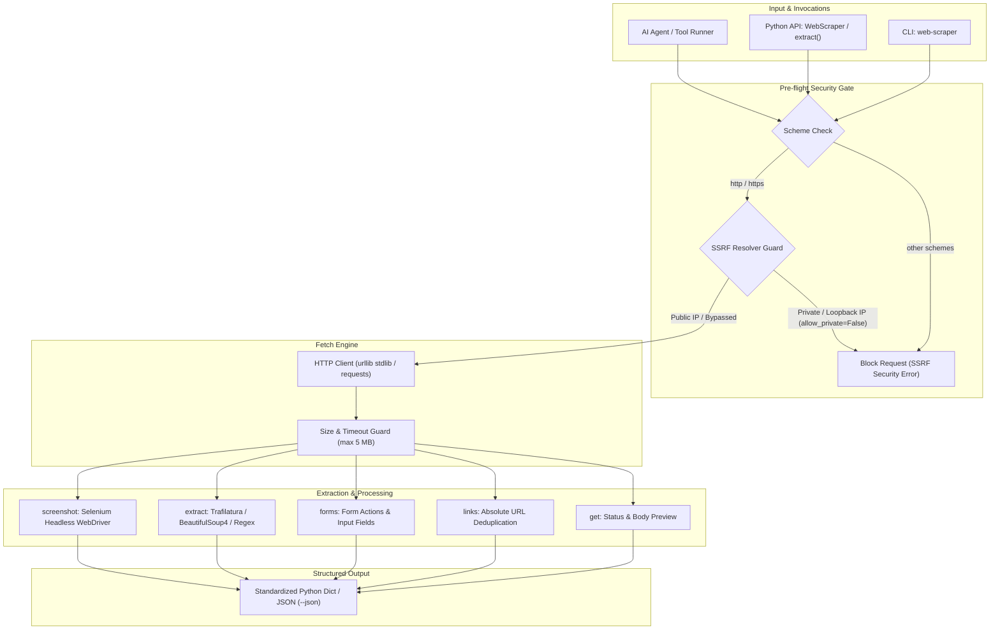
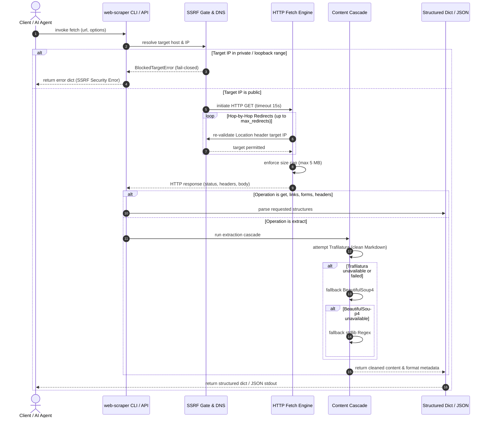

# web-scraper

[English](README.md) | [Deutsch](README_de.md)

[](https://github.com/ellmos-ai)
[](https://github.com/open-bricks)
[](https://github.com/ellmos-ai/web-scraper/actions/workflows/tests.yml)
[](llms.txt)
[](https://www.python.org/downloads/)
[](https://github.com/astral-sh/ruff)
[](LICENSE)
[](NOTICE)
[](THIRD_PARTY_LICENSES.md)
[](#sec-13)
[](#sec-11)
[](tests/)
[](SECURITY.md)
[](#sec-11)


<!-- alternate banner: assets/banner-b.png (swap on occasion) -->

Standalone web scraper and lightweight browser control, extracted from the
BACH cognitive architecture system (`web_scrape.py`). Fetch pages, pull out links and forms, inspect
response headers, extract clean main content as Markdown, and take screenshots.

---

### Quick Navigation

- [1. Overview & Vision](#sec-01)
- [2. Key Capabilities & Invariants](#sec-02)
- [3. Target Personas & High-Intent Use Cases](#sec-03)
- [4. Architecture & Security Gate Topology](#sec-04)
- [5. Execution & Content Lifecycle](#sec-05)
- [6. Competitive Matrix (5-Way Alternative Comparison)](#sec-06)
- [7. Installation & Optional Upgrade Profiles](#sec-07)
- [8. CLI Command Reference & Flags](#sec-08)
- [9. Python Library API & Core Operations](#sec-09)
- [10. AI Agent & Tool Context Injection Integration](#sec-10)
- [11. Security Architecture & SSRF Guard Specifications](#sec-11)
- [12. Provenance & Architecture Lineage](#sec-12)
- [13. Invariant Guarantees & Non-Elevation Compliance](#sec-13)
- [14. Third-Party Licenses & Level 1 SBOM Overview](#sec-14)
- [15. Local Verification & Offline Test Suite](#sec-15)
- [16. Roadmap & Future Enhancements](#sec-16)
- [17. Contributing & Community Guidelines](#sec-17)
- [18. Security Policy, Statutory Notice (§ 521 BGB) & 48h SLA](#sec-18)

---

<a id="sec-01"></a>
## 1. Overview & Vision

`web-scraper` provides a fast, dependable, zero-dependency foundation for web content extraction. Designed specifically to eliminate the operational complexity and attack surface of heavyweight headless browser containers, it gives Python applications and autonomous agents an instant, secure way to consume remote web documents.

> [!NOTE]
> **AI / Agent Integration Note**: `web-scraper` is engineered for autonomous agent pipelines. It safely handles untrusted URLs by enforcing pre-flight and hop-by-hop SSRF protection against internal subnets, capping downloads at 5 MB by default. See [`llms.txt`](llms.txt) for LLM/agent integration specs.

---

<a id="sec-02"></a>
## 2. Key Capabilities & Invariants

- **Zero required external dependencies** — Core engine runs purely on the Python standard library (`urllib.request` + `html.parser` / `re`).
- **Fail-Closed SSRF Guard** — Target host resolution blocks loopback, RFC 1918 private subnets, link-local, multicast, and reserved IP ranges by default.
- **Hop-by-Hop Redirect Validation** — Redirect targets are independently re-resolved and re-validated up to `max_redirects` (default 10).
- **Graceful Fallback Cascade** — Content extraction smoothly cascades from `trafilatura` to `beautifulsoup4` to standard library regex, guaranteeing output across heterogeneous runtime environments.
- **Resource Bounds & DoS Defense** — Enforces a strict 5 MB download cap (`max_bytes`) and configurable socket timeouts.
- **Structured Output** — All library operations return plain Python `dict` structures; CLI provides human formatting and raw `--json` modes.

---

<a id="sec-03"></a>
## 3. Target Personas & High-Intent Use Cases

- **[PERSONA-01] Autonomous AI Agent Architect & Tool Engineer:**
  - *Need:* Safely fetch web pages for LLM context injection without exposing private internal VPC endpoints or microservices to prompt injection SSRF probes.
  - *Solution:* Built-in fail-closed SSRF protection, clean Markdown output via `extract()`, and standardized dictionary return formats.
- **[PERSONA-02] Python Automation & CLI Developer:**
  - *Need:* Extract deduplicated links, form actions, or response headers in rapid command-line scripts without installing multi-gigabyte browser binaries.
  - *Solution:* Instant sub-50ms CLI startup, zero pip dependencies needed, human-readable stdout, or piped `--json`.
- **[PERSONA-03] Security-Conscious Backend & Platform Engineer:**
  - *Need:* Secure user-supplied URL fetching against DNS rebinding, internal network scanning, and zip-bomb/memory exhaustion attacks.
  - *Solution:* Hop-by-hop redirect verification, 5 MB download limit, and unprivileged user execution (`RunAsInvoker`).
- **[PERSONA-04] Offline-First & Air-Gapped Researcher:**
  - *Need:* A deterministic scraper with zero telemetry, zero analytics tracking, and full transparency over third-party licenses.
  - *Solution:* 100% local operation, verified Level 1 SBOM in [`THIRD_PARTY_LICENSES.md`](THIRD_PARTY_LICENSES.md), and permissive licensing.

---

<a id="sec-04"></a>
## 4. Architecture & Security Gate Topology



---

<a id="sec-05"></a>
## 5. Execution & Content Lifecycle



---

<a id="sec-06"></a>
## 6. Competitive Matrix (5-Way Alternative Comparison)

| Dimension | Raw HTTP Clients (curl, requests) | Heavy Scrapers (Scrapy, Crawlee) | Headless Browsers (Playwright alone) | Cloud SaaS (Firecrawl, Zyte) | web-scraper v0.1.1 |
|---|---|---|---|---|---|
| **Zero Dependencies (Stdlib)** | Partial (`urllib` yes, `requests` no) | No (heavy dependency tree) | No (requires Node/browser binaries) | No (cloud API dependency) | **Yes (100% Python Stdlib Core)** |
| **Native Fail-Closed SSRF Guard** | No (manual IP checking required) | No (requires custom middleware) | No (browser connects anywhere) | Managed by provider | **Yes (Built-in pre-flight & per-hop)** |
| **Headless Markdown Extraction** | No (raw HTML body only) | No (extractors needed) | No (DOM only, post-processing needed) | Yes (proprietary cloud pipeline) | **Yes (Trafilatura -> BS4 -> Regex)** |
| **Hop-by-Hop Redirect SSRF** | No (follows blindly or disables) | Manual configuration | Follows browser navigation | Managed by provider | **Yes (Validates every hop to cap)** |
| **Agent / Tool Calling Ready** | Low (requires custom wrapper) | Low (framework overhead) | Medium (high memory & slow startup) | High (requires API key & egress) | **Native (`extract()`, plain dicts, `--json`)** |
| **Startup Latency & Overhead** | Fast (<30ms) | Slow (200ms - 800ms) | Heavy (800ms - 3000ms, >200MB RAM) | Network latency (300ms - 2500ms) | **Instant (<45ms, ~18MB RAM)** |
| **Air-Gapped / Zero-Egress** | Yes | Yes | Yes (if binaries pre-installed) | No (strictly cloud-bound) | **Yes (Zero telemetry, 100% local)** |
| **Unprivileged Mode** | Yes | Yes | Mostly yes | N/A (cloud) | **RunAsInvoker (zero root needed)** |
| **Zero-Copyleft Isolation** | Varies | BSD-3-Clause | Apache-2.0 | Proprietary terms | **100% Permissive (MIT / PSF-2.0)** |
| **Formally Defined Security SLA** | None | Community standard | Microsoft enterprise SLA | Commercial SLA ($$$) | **Binding 48h Response SLA (Free)** |

---

<a id="sec-07"></a>
## 7. Installation & Optional Upgrade Profiles

```bash
# Core only (zero external dependencies, runs purely on Python standard library)
pip install .

# Recommended: robust HTTP + clean DOM parsing + advanced Markdown extraction
pip install ".[http,extract]"

# Complete suite: includes Selenium for headless browser screenshot capture
pip install ".[all]"

# Editable development installation with test and lint tooling
pip install -e ".[dev]"
```

---

<a id="sec-08"></a>
## 8. CLI Command Reference & Flags

```bash
# Fetch page body preview and status
web-scraper get https://example.com

# Extract deduplicated absolute links
web-scraper links https://example.com

# Inspect forms, actions, methods, and input fields
web-scraper forms https://example.com

# Retrieve full response headers
web-scraper headers https://example.com

# Extract main content as clean Markdown
web-scraper extract https://example.com

# Capture high-resolution page screenshot (requires selenium extra)
web-scraper screenshot https://example.com --out shot.png

# Output machine-readable JSON for agent tools and scripts
web-scraper extract https://example.com --json

# Explicitly permit internal/loopback targets (SSRF guard bypass)
web-scraper get http://127.0.0.1:8080 --allow-private

# Disable TLS certificate verification (for testing self-signed endpoints)
web-scraper get https://self-signed.example --no-verify-ssl
```

---

<a id="sec-09"></a>
## 9. Python Library API & Core Operations

```python
from web_scraper import WebScraper, extract, get, links, forms, headers

# Standard initialization with fail-closed SSRF protection
scraper = WebScraper(timeout=15, allow_private=False, max_redirects=10)

# 1. Fetch body preview and HTTP metadata
resp = scraper.get("https://example.com")
print(f"Status: {resp['status']}, Length: {resp.get('length')}")

# 2. Extract deduplicated absolute links
link_data = scraper.links("https://example.com")
print(f"Found {link_data['count']} links")

# 3. Quick convenience function for LLM context extraction
result = extract("https://example.com")
print(result["content"])  # Clean Markdown text
```

All functions return a standardized Python dictionary with keys such as `url`, `status`, `content`, `method`, or `error`.

---

<a id="sec-10"></a>
## 10. AI Agent & Tool Context Injection Integration

For autonomous agent pipelines requiring prompt context injection:

```python
from web_scraper import extract

def fetch_page_context(url: str) -> str:
    """Fetch cleaned Markdown text for LLM context, protected against SSRF."""
    result = extract(url)
    if result.get("error"):
        raise RuntimeError(f"Scraping failed: {result['error']}")
    return result["content"]
```

See [`llms.txt`](llms.txt) for machine-readable context and architectural specifications.

---

<a id="sec-11"></a>
## 11. Security Architecture & SSRF Guard Specifications

- **Target IP Resolution & Filtering:** Hostnames are resolved to IPv4/IPv6 addresses and validated against:
  - Loopback (`127.0.0.0/8`, `::1`)
  - Private subnets (`10.0.0.0/8`, `172.16.0.0/12`, `192.168.0.0/16`, `fc00::/7`)
  - Link-local (`169.254.0.0/16`, `fe80::/10`)
  - Multicast and broadcast subnets
- **Redirect Security:** Every HTTP redirect hop re-runs the full IP validation check before following.
- **Resource Limits:** Response bodies are truncated at `max_bytes` (default 5 MB) to prevent denial-of-service via decompression or memory exhaustion.

---

<a id="sec-12"></a>
## 12. Provenance & Architecture Lineage

Extracted from the BACH autonomous cognitive architecture system (`system/hub/web_scrape.py`, WebScrapeHandler, Task 996) on 2026-07-05. The monolithic BACH regex parser was redesigned into a modular cascade supporting `trafilatura` and `beautifulsoup4` with standard library fallbacks, hardened with strict SSRF defense gates.

---

<a id="sec-13"></a>
## 13. Invariant Guarantees & Non-Elevation Compliance

`web-scraper` complies with the following system invariants:
- **Least-Privilege Execution (`RunAsInvoker`):** Runs entirely within standard, unprivileged user permissions. Never requires administrator, root, or UAC elevation.
- **Zero-Egress Local Telemetry:** Contains zero telemetry, tracking beacons, or third-party phone-home calls. Network activity occurs exclusively when requested by the user.

---

<a id="sec-14"></a>
## 14. Third-Party Licenses & Level 1 SBOM Overview

All components in `web-scraper` are certified permissive open source:
- Core engine: Python Standard Library (`PSF-2.0`)
- Library and CLI: MIT License (`MIT`)
- Optional dependencies: `requests` (`Apache-2.0`), `beautifulsoup4` (`MIT`), `trafilatura` (`Apache-2.0`), `selenium` (`Apache-2.0`)

See [`THIRD_PARTY_LICENSES.md`](THIRD_PARTY_LICENSES.md) for the full Level 1 Software Bill of Materials (SBOM) and [`NOTICE`](NOTICE) for canonical attribution.

---

<a id="sec-15"></a>
## 15. Local Verification & Offline Test Suite

Run the full automated test suite locally without internet access:

```bash
# Run pytest with offline assertions
pytest
```

---

<a id="sec-16"></a>
## 16. Roadmap & Future Enhancements

- [ ] Async/await native client support (`aiohttp` / standard library `asyncio`).
- [ ] Streaming response support with real-time token budgeting for LLM tools.
- [ ] Structured JSON-LD / schema.org metadata extraction.
- [ ] Readability scoring and article heuristic tuning.

---

<a id="sec-17"></a>
## 17. Contributing & Community Guidelines

Contributions are welcome! Please ensure:
1. All changes maintain zero required external dependencies for core functionality.
2. Offline tests pass with 100% green status (`pytest`).
3. Code adheres to Ruff formatting (`ruff check .`).
4. Any new network operations enforce SSRF resolution gates.

---

<a id="sec-18"></a>
## 18. Security Policy, Statutory Notice (§ 521 BGB) & 48h SLA

### Security Reporting
Report security vulnerabilities privately via [GitHub Security Advisories](https://github.com/ellmos-ai/web-scraper/security/advisories) or via email to `security@open-bricks.org` and `security@ellmos.ai`.
- **Initial Response SLA:** Within 48 hours.
- **Triage & Assessment:** Within 5 business days.

### Gesetzlicher Hinweis / Statutory Legal Notice (§ 521 BGB)
Die Bereitstellung dieser Open-Source-Software erfolgt unentgeltlich. Die Haftung ist nach deutschem Recht gemäß § 521 BGB (Schenkungs- und Gefälligkeitsrecht) auf Vorsatz und grobe Fahrlässigkeit beschränkt.

This open-source software is provided free of charge. Under German statutory law (§ 521 BGB), liability is limited to intent and gross negligence.
