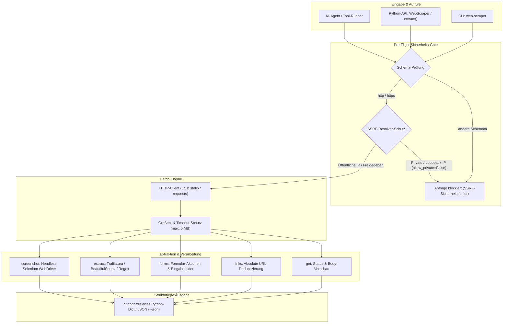
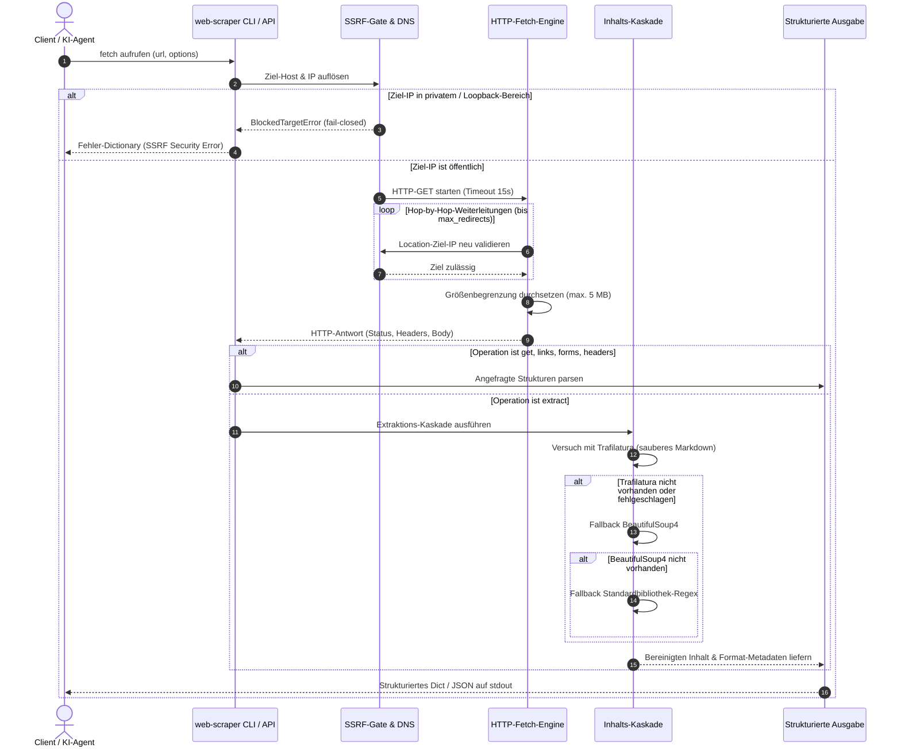

# web-scraper

[English](README.md) | [Deutsch](README_de.md)

[](https://github.com/ellmos-ai)
[](https://github.com/open-bricks)
[](https://github.com/ellmos-ai/web-scraper/actions/workflows/tests.yml)
[](llms.txt)
[](https://www.python.org/downloads/)
[](https://github.com/astral-sh/ruff)
[](LICENSE)
[](NOTICE)
[](THIRD_PARTY_LICENSES.md)
[](#sec-13)
[](#sec-11)
[](tests/)
[](SECURITY.md)
[](#sec-11)


<!-- alternate banner: assets/banner-b.png (swap on occasion) -->

Eigenständiger Web-Scraper und schlanke Browser-Steuerung, extrahiert aus dem
BACH-Kognitionsarchitektur-System (`web_scrape.py`). Webseiten abrufen, Links und Formulare herauslösen,
Response-Header analysieren, sauberen Haupttext als Markdown extrahieren und Screenshots erstellen.

---

### Schnellnavigation

- [1. Übersicht & Vision](#sec-01)
- [2. Kernfunktionen & Invarianten](#sec-02)
- [3. Zielgruppen-Personas & Anwendungsfälle](#sec-03)
- [4. Architektur & Sicherheits-Gate-Topologie](#sec-04)
- [5. Ausführungs- & Inhalts-Lebenszyklus](#sec-05)
- [6. Vergleichsmatrix (5-Wege-Alternativenvergleich)](#sec-06)
- [7. Installation & optionale Upgrade-Profile](#sec-07)
- [8. CLI-Befehlsreferenz & Parameter](#sec-08)
- [9. Python-Bibliotheks-API & Kernoperationen](#sec-09)
- [10. KI-Agenten- & Tool-Kontextinjektion](#sec-10)
- [11. Sicherheitsarchitektur & SSRF-Schutz](#sec-11)
- [12. Provenienz & Architektur-Herkunft](#sec-12)
- [13. Invarianten-Garantien & Rechteverzicht (RunAsInvoker)](#sec-13)
- [14. Drittanbieter-Lizenzen & Level-1-SBOM-Übersicht](#sec-14)
- [15. Lokale Verifikation & Offline-Testsuite](#sec-15)
- [16. Roadmap & Zukunftsplanung](#sec-16)
- [17. Mitwirken & Community-Richtlinien](#sec-17)
- [18. Sicherheitsrichtlinie, Gesetzlicher Hinweis (§ 521 BGB) & 48h-SLA](#sec-18)

---

<a id="sec-01"></a>
## 1. Übersicht & Vision

`web-scraper` bietet ein schnelles, zuverlässiges und im Kern abhängigkeitsfreies Fundament zur Web-Inhaltsextraktion. Konzipiert, um die betriebliche Komplexität und Angriffsfläche schwerfälliger Headless-Browser-Container zu eliminieren, ermöglicht das Modul Python-Anwendungen und autonomen KI-Agenten den sofortigen, sicheren Zugriff auf Webinhalte.

> [!NOTE]
> **KI- / Agenten-Integrationshinweis**: `web-scraper` wurde für autonome KI-Agenten-Pipelines entwickelt. Das Modul verarbeitet externe URLs sicher durch integrierten Vorab- und Hop-by-Hop-SSRF-Schutz gegen interne Subnetze sowie ein Standard-Download-Limit von 5 MB. Siehe [`llms.txt`](llms.txt) für Spezifikationen zur KI/Agenten-Integration.

---

<a id="sec-02"></a>
## 2. Kernfunktionen & Invarianten

- **Keine Pflicht-Abhängigkeiten** — Der Kern läuft vollständig auf der Python-Standardbibliothek (`urllib.request` + `html.parser` / `re`).
- **Fail-Closed SSRF-Schutz** — Zielhost-Auflösung blockiert standardmäßig Loopback, private RFC-1918-Netze, Link-Local-, Multicast- und reservierte IP-Bereiche.
- **Hop-by-Hop-Redirect-Prüfung** — Weiterleitungsziele werden bei jedem Hop separat neu aufgelöst und validiert, bis zum Limit `max_redirects` (Standard 10).
- **Robuste Fallback-Kaskade** — Die Inhaltsextraktion kaskadiert geschmeidig von `trafilatura` über `beautifulsoup4` bis zum Standardbibliothek-Regex.
- **Ressourcenbegrenzung & DoS-Schutz** — Festes Download-Limit von 5 MB (`max_bytes`) und konfigurierbare Socket-Timeouts.
- **Strukturierte Ausgaben** — Alle API-Methoden liefern native Python-Dictionaries; CLI bietet formatierte Text- und maschinenlesbare `--json`-Ausgabe.

---

<a id="sec-03"></a>
## 3. Zielgruppen-Personas & Anwendungsfälle

- **[PERSONA-01] Architekt autonomer KI-Agenten & Tool-Entwickler:**
  - *Bedarf:* Sicheres Laden von Webseiten für LLM-Kontextinjektion ohne Gefahr, dass böswillige Prompts interne VPC-Endpunkte via SSRF ausspähen.
  - *Lösung:* Standardmäßiger Fail-Closed SSRF-Schutz, saubere Markdown-Extraktion via `extract()` und deterministische Rückgabeformate.
- **[PERSONA-02] Python-Automatisierer & CLI-Entwickler:**
  - *Bedarf:* Schnelles Extrahieren deduplizierter Links, Formular-Aktionen oder Header in Skripten ohne tonnenschwere Browser-Treiber.
  - *Lösung:* Startzeit unter 50 ms, keine Drittanbieter-Pakete erforderlich, menschenlesbare Ausgabe oder JSON für Pipes.
- **[PERSONA-03] Sicherheitsbewusster Backend- & Plattform-Ingenieur:**
  - *Bedarf:* Absicherung von Systemen gegen DNS-Rebinding, Scans privater Subnetze und Speichererschöpfung durch Zip-Bomben.
  - *Lösung:* Hop-by-Hop-Validierung, 5-MB-Größenlimit und Ausführung mit Standard-Benutzerrechten (`RunAsInvoker`).
- **[PERSONA-04] Offline-First- & Air-Gapped-Forscher:**
  - *Bedarf:* Deterministisches Tooling ohne Telemetrie, Tracking und mit vollständiger Lizenztransparenz.
  - *Lösung:* 100 % lokaler Betrieb, zertifizierte Level-1-SBOM in [`THIRD_PARTY_LICENSES.md`](THIRD_PARTY_LICENSES.md) und rein permissive Lizenzen.

---

<a id="sec-04"></a>
## 4. Architektur & Sicherheits-Gate-Topologie



---

<a id="sec-05"></a>
## 5. Ausführungs- & Inhalts-Lebenszyklus



---

<a id="sec-06"></a>
## 6. Vergleichsmatrix (5-Wege-Alternativenvergleich)

| Kriterium | Reine HTTP-Clients (curl, requests) | Schwere Scraper (Scrapy, Crawlee) | Headless-Browser (Playwright allein) | Cloud-SaaS (Firecrawl, Zyte) | web-scraper v0.1.1 |
|---|---|---|---|---|---|
| **Zero Dependencies (Stdlib)** | Teils (`urllib` ja, `requests` nein) | Nein (großer Abhängigkeitsbaum) | Nein (benötigt Node/Browser-Binaries) | Nein (Cloud-API-Abhängigkeit) | **Ja (100 % Python-Standardbibliothek)** |
| **Nativer Fail-Closed SSRF-Schutz** | Nein (manuelle IP-Prüfung nötig) | Nein (benötigt Middleware) | Nein (Browser verbindet beliebig) | Durch Cloud-Anbieter verwaltet | **Ja (Integrierter Vorab- & Hop-Schutz)** |
| **Headless Markdown-Extraktion** | Nein (nur roher HTML-Body) | Nein (Extraktoren erforderlich) | Nein (nur DOM, Nachbearbeitung nötig) | Ja (proprietäre Cloud-Pipeline) | **Ja (Trafilatura -> BS4 -> Regex)** |
| **Hop-by-Hop-Redirect-Validierung** | Nein (folgt blind oder deaktiviert) | Manuelle Konfiguration | Folgt Browser-Navigation | Durch Cloud-Anbieter verwaltet | **Ja (Jeder Hop bis zum Limit geprüft)** |
| **KI-Agenten / Tool-Calling** | Gering (benötigt Wrapper) | Gering (Framework-Overhead) | Mittel (hoher RAM & langsame Starts) | Hoch (erfordert API-Key & Egress) | **Nativ (`extract()`, Dicts, `--json`)** |
| **Startzeit & Ressourcenbedarf** | Schnell (<30 ms) | Langsam (200 ms - 800 ms) | Schwer (800 ms - 3000 ms, >200 MB) | Netzwerklatenz (300 ms - 2500 ms) | **Sofort (<45 ms, ~18 MB RAM)** |
| **Air-Gapped / Zero-Egress** | Ja | Ja | Ja (wenn Binaries lokal) | Nein (rein cloud-gebunden) | **Ja (Zero Telemetrie, 100 % lokal)** |
| **Rechteverzicht** | Ja | Ja | Größtenteils ja | N/A (Cloud) | **RunAsInvoker (keine Root-Rechte)** |
| **Zero-Copyleft-Isolation** | Variiert | BSD-3-Clause | Apache-2.0 | Proprietäre Bedingungen | **100 % Permissiv (MIT / PSF-2.0)** |
| **Verbindliche Sicherheits-SLA** | Keine | Community-Standard | Microsoft Enterprise SLA | Kommerzielle SLA ($$$) | **Verbindliche 48h-Reaktions-SLA** |

---

<a id="sec-07"></a>
## 7. Installation & optionale Upgrade-Profile

```bash
# Nur Kern (keine externen Abhängigkeiten, reine Standardbibliothek)
pip install .

# Empfohlen: robuste HTTP-Engine + DOM-Parsing + Markdown-Extraktion
pip install ".[http,extract]"

# Vollständige Suite: inklusive Selenium für Headless-Browser-Screenshots
pip install ".[all]"

# Entwicklungsinstallation mit Test- und Linter-Werkzeugen
pip install -e ".[dev]"
```

---

<a id="sec-08"></a>
## 8. CLI-Befehlsreferenz & Parameter

```bash
# Seiteninhalt-Vorschau und HTTP-Status abrufen
web-scraper get https://example.com

# Deduplizierte absolute Links extrahieren
web-scraper links https://example.com

# Formulare, Aktionen, Methoden und Felder auflisten
web-scraper forms https://example.com

# Vollständige HTTP-Antwort-Header einsehen
web-scraper headers https://example.com

# Bereinigten Hauptinhalt als Markdown extrahieren
web-scraper extract https://example.com

# Hochauflösenden Screenshot erstellen (erfordert selenium-Extra)
web-scraper screenshot https://example.com --out shot.png

# Maschinenlesbares JSON für Skripte und Agenten ausgeben
web-scraper extract https://example.com --json

# Interne/Loopback-Ziele explizit freigeben (SSRF-Bypass)
web-scraper get http://127.0.0.1:8080 --allow-private

# TLS-Zertifikatsprüfung überspringen (für lokale Selbstsignierung)
web-scraper get https://self-signed.example --no-verify-ssl
```

---

<a id="sec-09"></a>
## 9. Python-Bibliotheks-API & Kernoperationen

```python
from web_scraper import WebScraper, extract, get, links, forms, headers

# Standard-Initialisierung mit sicherem SSRF-Schutz
scraper = WebScraper(timeout=15, allow_private=False, max_redirects=10)

# 1. Body-Vorschau und Metadaten abrufen
resp = scraper.get("https://example.com")
print(f"Status: {resp['status']}, Länge: {resp.get('length')}")

# 2. Deduplizierte absolute Links abfragen
link_daten = scraper.links("https://example.com")
print(f"Gefundene Links: {link_daten['count']}")

# 3. Direkte Hilfsfunktion für LLM-Kontextinjektion
ergebnis = extract("https://example.com")
print(ergebnis["content"])  # Sauberer Markdown-Text
```

Alle Methoden liefern ein standardisiertes Python-Dictionary mit Schlüsseln wie `url`, `status`, `content`, `method` oder `error`.

---

<a id="sec-10"></a>
## 10. KI-Agenten- & Tool-Kontextinjektion

Für autonome Agenten-Pipelines zur Prompt-Kontextinjektion:

```python
from web_scraper import extract

def fetch_page_context(url: str) -> str:
    """Bereinigten Markdown-Text für LLM-Kontext sicher gegen SSRF abrufen."""
    result = extract(url)
    if result.get("error"):
        raise RuntimeError(f"Scraping fehlgeschlagen: {result['error']}")
    return result["content"]
```

Siehe [`llms.txt`](llms.txt) für maschinenlesbare Kontext- und Integrationsspezifikationen.

---

<a id="sec-11"></a>
## 11. Sicherheitsarchitektur & SSRF-Schutz

- **IP-Auflösung & Filterung:** Hostnamen werden zu IPv4/IPv6 aufgelöst und vor dem Verbindungsaufbau geprüft gegen:
  - Loopback (`127.0.0.0/8`, `::1`)
  - Private Subnetze (`10.0.0.0/8`, `172.16.0.0/12`, `192.168.0.0/16`, `fc00::/7`)
  - Link-Local (`169.254.0.0/16`, `fe80::/10`)
  - Multicast- und Rundsende-Netze
- **Redirect-Schutz:** Jeder einzelne HTTP-Weiterleitungs-Hop durchläuft die IP-Prüfung erneut.
- **Ressourcenlimits:** Antwort-Bodys werden bei `max_bytes` (Standard 5 MB) gekappt, um Denial-of-Service durch Dekomprimierungs- und Speicherangriffe zu verhindern.

---

<a id="sec-12"></a>
## 12. Provenienz & Architektur-Herkunft

Portiert aus dem BACH-Kognitionsarchitektur-System (`system/hub/web_scrape.py`, WebScrapeHandler, Task 996) am 2026-07-05. Der monolithische BACH-Regex-Parser wurde in eine modulare Kaskade überführt, die `trafilatura` und `beautifulsoup4` mit Standardbibliothek-Fallbacks unterstützt und mit strikten SSRF-Schutzbarrieren gehärtet wurde.

---

<a id="sec-13"></a>
## 13. Invarianten-Garantien & Rechteverzicht (RunAsInvoker)

`web-scraper` erfüllt verbindliche Systeminvarianten:
- **Ausführung mit geringsten Rechten (`RunAsInvoker`):** Läuft vollständig im Rahmen standardmäßiger Benutzerrechte. Erfordert zu keinem Zeitpunkt Administrator-, Root- oder UAC-Rechte.
- **Keine Telemetrie / Zero-Egress:** Enthält keinerlei Telemetrie, Analyse-Tracker oder Hintergrundverbindungen. Netzwerkaktivität erfolgt ausschließlich zielgerichtet auf Anweisung des Benutzers.

---

<a id="sec-14"></a>
## 14. Drittanbieter-Lizenzen & Level-1-SBOM-Übersicht

Alle Komponenten von `web-scraper` sind als permissive Open-Source-Software zertifiziert:
- Kernmodul: Python-Standardbibliothek (`PSF-2.0`)
- Bibliothek und CLI: MIT-Lizenz (`MIT`)
- Optionale Pakete: `requests` (`Apache-2.0`), `beautifulsoup4` (`MIT`), `trafilatura` (`Apache-2.0`), `selenium` (`Apache-2.0`)

Siehe [`THIRD_PARTY_LICENSES.md`](THIRD_PARTY_LICENSES.md) für die vollständige Software Bill of Materials (SBOM) und [`NOTICE`](NOTICE) für kanonische Urheberangaben.

---

<a id="sec-15"></a>
## 15. Lokale Verifikation & Offline-Testsuite

Führen Sie die vollständige Testsuite lokal und ohne Internetverbindung aus:

```bash
# Pytest mit Offline-Zusicherungen ausführen
pytest
```

---

<a id="sec-16"></a>
## 16. Roadmap & Zukunftsplanung

- [ ] Native Async/Await-Unterstützung (`aiohttp` / Standardbibliothek `asyncio`).
- [ ] Streaming-Antworten mit Echtzeit-Token-Budgetierung für LLM-Werkzeuge.
- [ ] Strukturierte Extraktion von JSON-LD- und Schema.org-Metadaten.
- [ ] Feintuning von Heuristiken zur Erkennung redaktioneller Artikel.

---

<a id="sec-17"></a>
## 17. Mitwirken & Community-Richtlinien

Beiträge sind herzlich willkommen! Bitte beachten Sie:
1. Der Kern muss ohne externe Drittanbieter-Abhängigkeiten funktionsfähig bleiben.
2. Alle Offline-Tests müssen zu 100 % grün durchlaufen (`pytest`).
3. Der Code muss den Vorgaben des Ruff-Linters entsprechen (`ruff check .`).
4. Neue Netzwerkoperationen müssen zwingend das SSRF-Gate durchlaufen.

---

<a id="sec-18"></a>
## 18. Sicherheitsrichtlinie, Gesetzlicher Hinweis (§ 521 BGB) & 48h-SLA

### Sicherheitsmeldungen
Sicherheitslücken bitte vertraulich über [GitHub Security Advisories](https://github.com/ellmos-ai/web-scraper/security/advisories) oder per E-Mail an `security@open-bricks.org` und `security@ellmos.ai` melden.
- **Reaktions-SLA:** Eingangsbestätigung innerhalb von 48 Stunden.
- **Triage & Ersteinschätzung:** Innerhalb von 5 Werktagen.

### Gesetzlicher Hinweis (§ 521 BGB)
Die Bereitstellung dieser Open-Source-Software erfolgt unentgeltlich. Die Haftung ist nach deutschem Recht gemäß § 521 BGB (Schenkungs- und Gefälligkeitsrecht) auf Vorsatz und grobe Fahrlässigkeit beschränkt.

This open-source software is provided free of charge. Under German statutory law (§ 521 BGB), liability is limited to intent and gross negligence.
